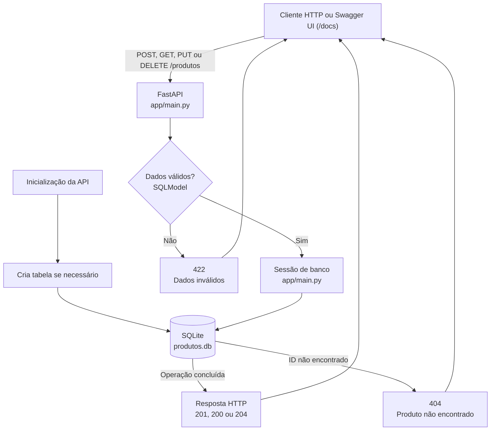

# API de Produtos

API REST CRUD simples para cadastro de produtos, desenvolvida com Python,
FastAPI, SQLModel e SQLite.

## Estrutura do projeto

```text
.
├── app/
│   ├── __init__.py
│   ├── database.py
│   ├── main.py
│   └── models.py
├── tests/
│   └── test_produtos.py
├── .gitignore
├── README.md
└── requirements.txt
```

- `app/main.py`: cria a aplicação, inicializa a tabela e implementa os endpoints.
- `app/database.py`: configura o arquivo SQLite e fornece sessões ao FastAPI.
- `app/models.py`: define os campos e as validações dos produtos com SQLModel.
- `tests/test_produtos.py`: testa a API usando um SQLite em memória, separado do banco local.
- `requirements.txt`: lista as dependências necessárias.

## Visão geral do projeto

O diagrama mostra como uma requisição passa pela API até chegar ao banco de
dados. A tabela é criada na inicialização da aplicação; entradas inválidas
recebem `422` e IDs inexistentes recebem `404`.



## Requisitos

- Python 3.11 ou superior

## Instalação no Windows PowerShell

Na pasta do projeto, crie e ative o ambiente virtual:

```powershell
py -3.11 -m venv .venv
.\.venv\Scripts\Activate.ps1
```

Instale as dependências:

```powershell
python -m pip install --upgrade pip
pip install -r requirements.txt
```

Se o comando `py -3.11` não estiver disponível, use `python -m venv .venv`
com uma instalação Python 3.11 ou superior.

## Executar a API

Com o ambiente virtual ativado:

```powershell
uvicorn app.main:app --reload
```

A API estará disponível em <http://127.0.0.1:8000>. Na primeira inicialização,
a tabela é criada automaticamente no arquivo `produtos.db`, na pasta do projeto.

## Documentação interativa e endpoints

Abra <http://127.0.0.1:8000/docs> para experimentar os endpoints pela interface
Swagger UI. Selecione um endpoint, clique em **Try it out**, preencha os dados e
clique em **Execute**.

Os campos de um produto são:

```json
{
  "nome": "Caderno",
  "descricao": "Caderno universitário",
  "preco": 19.9
}
```

- `POST /produtos`: cria um produto; retorna `201`.
- `GET /produtos`: lista os produtos.
- `GET /produtos/{id}`: consulta um produto pelo ID; retorna `404` se não existir.
- `PUT /produtos/{id}`: substitui nome, descrição e preço; retorna `404` se não existir.
- `DELETE /produtos/{id}`: exclui um produto; retorna `204` ou `404` se não existir.

O nome não pode ser vazio e o preço precisa ser maior que zero. Dados inválidos
retornam `422` com detalhes da validação.

## Executar os testes

Com o ambiente virtual ativado:

```powershell
python -m pytest -v
```

Os testes criam um banco SQLite em memória para cada execução e não alteram
`produtos.db`.
